

# Smart-Screen

**جایگزین مدرن برنامهٔ «UsbMonitor» برای نمایشگرهای ۳٫۵ اینچی USB مانیتورینگ سیستم (Turing Smart Screen نسخهٔ rev A و مشابه‌ها).**

[English](README.md) · فارسی · [وب‌سایت](https://plus98ir.github.io/Smart-Screen/)

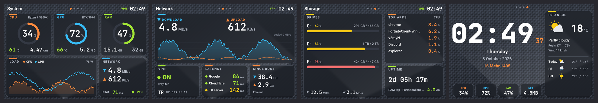

## با چه نمایشگرهایی کار می‌کند؟

Smart-Screen با **پروتکل سریال rev A** (USB CDC، سرعت 115200) با نمایشگر صحبت می‌کند و مخصوص این مدل‌هاست:

| نمایشگر | اندازه / رزولوشن | چطور بشناسیم |
|---|---|---|
| **Turing Smart Screen 3.5"** (اصلی، rev A) | ۳٫۵ اینچ، 320×480 | شناسهٔ USB در Device Manager: `VID_1A86 & PID_5722` |
| **نمایشگرهای IPS سه‌ونیم اینچی «UsbMonitor» / «UsbPCMonitor»** (مدل‌های علی‌اکسپرس و آمازون، معمولاً با نام «3.5 inch IPS USB-C computer monitor / AIDA64 sub-screen») | ۳٫۵ اینچ، 320×480 | همراهش برنامهٔ **UsbMonitor.exe** آمده؛ شمارهٔ سریال USB: `USB35INCHIPSV2` |

هر دو خودکار پیدا می‌شوند (با شناسهٔ USB یا شمارهٔ سریال). اگر نمایشگر شما روی پورت COM دیگری بود، در **Settings → Screen port** دستی انتخابش کنید.

**پشتیبانی نمی‌شود (پروتکل متفاوت):** Turing مدل‌های ۲٫۱، ۵ و ۸٫۸ اینچ (rev C)، XuanFang سه‌ونیم اینچ (rev B)، Kipye و WeAct (rev D). برای این‌ها از [turing-smart-screen-python](https://github.com/mathoudebine/turing-smart-screen-python) استفاده کنید.

**کامپیوتر:** ویندوز ۱۰ یا ۱۱ (۶۴ بیتی). پایتون 3.10 به بالا (اگر نباشد، نصب‌کننده پایتون 3.14 را با winget نصب می‌کند).

> اول برنامهٔ سازنده یعنی **UsbMonitor.exe** را ببندید. پورت COM نمایشگر فقط دست یک برنامه می‌تواند باشد؛ نصب‌کننده پیشنهاد می‌دهد اجرای خودکارش را خاموش کند.

## امکانات

- **۴ صفحه** که خودکار عوض می‌شوند یا ثابت می‌مانند:
  - **System**: گیج CPU / GPU / RAM، دما، فرکانس، توان، نمودار بار، شبکه و پینگ
  - **Network**: نمودار دانلود / آپلود، وضعیت VPN، IP عمومی و کشور، تأخیر HTTP به چند مقصد (و سرور خودتان، اختیاری)، ترافیک از زمان روشن شدن
  - **Storage**: همهٔ درایوها با نوار پرشدگی، سرعت خواندن / نوشتن دیسک، پرمصرف‌ترین برنامه‌ها، مدت روشن بودن
  - **Clock**: ساعت بزرگ، تاریخ میلادی و **شمسی**، آب‌وهوا با پیش‌بینی ۳ روزه
- **۸ تم**: HUD (قاب علمی‌تخیلی با گیج‌های حلقه‌ای، هر معیار یک رنگ)، Pulse (داشبورد یک‌تکه با گیج کمانی و نمودارهای کوچک)، Midnight، Neon (درخشان)، Ember، Frost (روشن)، Aurora و Carbon (پس‌زمینهٔ بافت‌دار که سایهٔ تصویر قبلی / سوختگی LCD را می‌پوشاند)
- **افقی و عمودی**، به‌علاوهٔ **چرخش ۱۸۰ درجه** و **آینه** (افقی / عمودی) برای نمایشگری که وارونه نصب شده یا از پشت شیشه دیده می‌شود
- **افکت عوض شدن صفحه** هنگام تغییر صفحه یا تم: Fade، Fade + dissolve، Wipe (پایین / بالا / راست / چپ)، Curtain، Iris، Diagonal، Blinds، Checkerboard، Spiral، Dissolve یا Random (پایین‌تر را ببینید)
- **اندازهٔ متن**: معمولی، بزرگ، خیلی بزرگ؛ عددها به‌جای بیرون زدن کوچک می‌شوند
- **روشنایی** و **کم‌نور شدن در شب** (بازهٔ ساعت)
- **سریع**: هر ثانیه یک فریم می‌کشد و فقط بخش‌های تغییرکرده را می‌فرستد، به‌علاوهٔ بازکشی کامل هر ۶۰ ثانیه (یا منوی آیکون ← Full redraw now) تا چیزی جا نماند
- **آیکون کنار ساعت ویندوز** برای همه‌چیز (تم، صفحه، چرخش، روشنایی، خاموش کردن نمایشگر، ری‌استارت) و **پنجرهٔ تنظیمات با پیش‌نمایش زنده**: تا Apply نزنید چیزی روی نمایشگر نمی‌رود
- **دمای واقعی** با LibreHardwareMonitor (CPU و کارت گرافیک) و `nvidia-smi` به‌عنوان پشتیبان برای کارت‌های NVIDIA
- **پینگ درست با VPN**: تأخیر به‌صورت رفت‌وبرگشت HTTP روی اتصال باز اندازه گرفته می‌شود تا VPNهای حالت TUN (v2rayN، sing-box، Clash و…) پینگ ۱ میلی‌ثانیه‌ای الکی نشان ندهند
- **آب‌وهوای مطمئن**: اگر جست‌وجوی شهر Open-Meteo روی شبکهٔ شما باز نشود، شهر از Photon / Nominatim پیدا می‌شود
- **پاک کردن سایهٔ تصویر**: چرخهٔ آرام رنگ با روشنایی کامل که به محو شدن تصویر ماندگار LCD کمک می‌کند
- **اجرا همراه ویندوز** (تسک زمان‌بندی‌شده با دسترسی ادمین که برای دمای CPU لازم است)، بدون پنجرهٔ UAC

## تصاویر

هر ۴ صفحه برای هر تم (خود برنامه با داده‌های نمونه کشیده است):

| تم | افقی (480×320) |
|---|---|
| HUD | 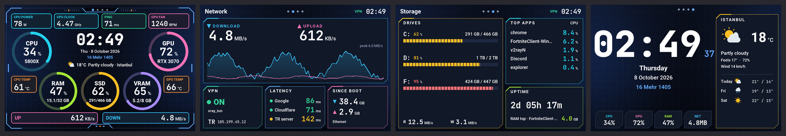 |
| Pulse | 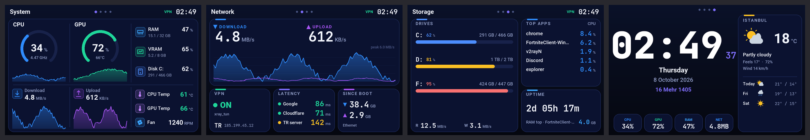 |
| Carbon |  |
| Aurora | 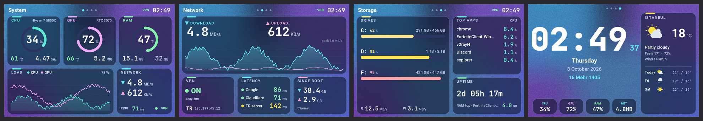 |
| Midnight | 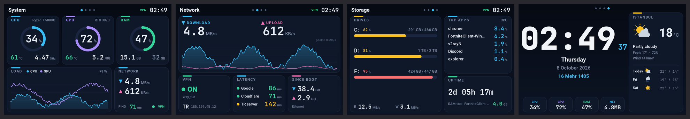 |
| Neon | 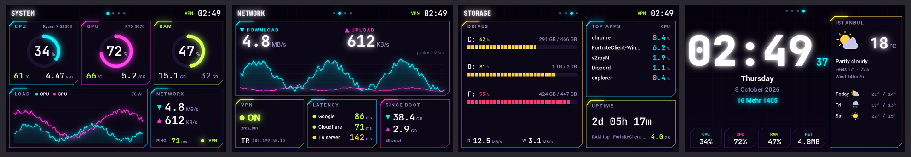 |
| Ember | 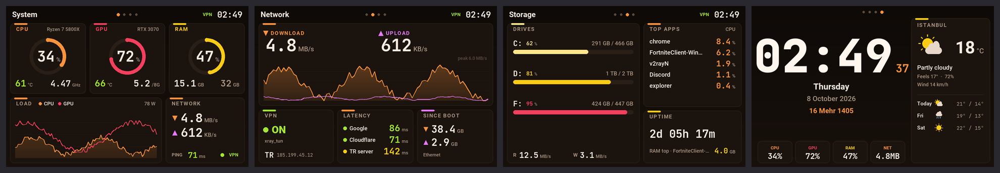 |
| Frost | 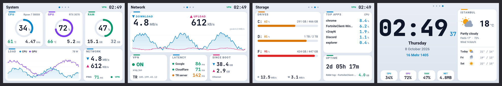 |

عمودی (320×480):

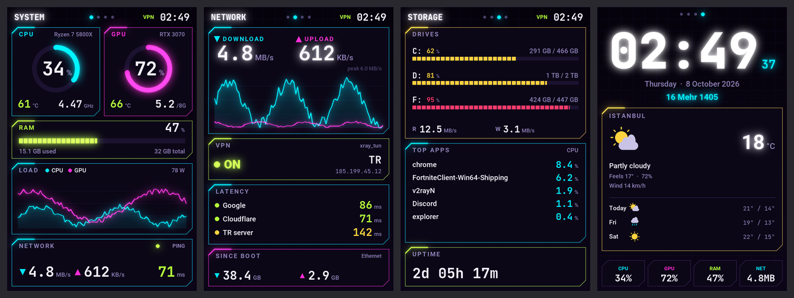

### افکت عوض شدن صفحه

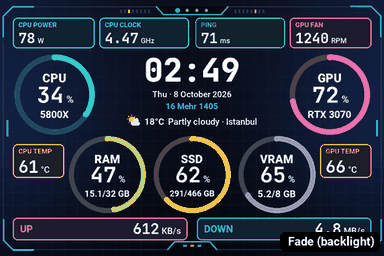

از منوی آیکون ← **Page effect** یا **Settings → Display → Page effect** انتخاب کنید (پیش‌فرض: **Fade**). افکت وقتی اجرا می‌شود که صفحه یا تم عوض شود؛ به‌روزرسانی معمولی هر ثانیه همچنان سریع می‌ماند.

| افکت | چه می‌بینید |
|---|---|
| Fade | نور پس‌زمینه تا سیاه کم می‌شود، صفحهٔ جدید در تاریکی کشیده می‌شود و بعد آرام روشن می‌شود (کشیده شدن اصلاً دیده نمی‌شود) |
| Fade + dissolve | کم‌نور می‌شود، صفحهٔ جدید تکه‌تکه با ترتیب تصادفی ظاهر می‌شود، بعد روشنایی کامل |
| Wipe down / up / right / left | صفحهٔ جدید از یک لبه وارد می‌شود |
| Curtain | مثل پرده از وسط به دو طرف باز می‌شود |
| Iris | از مرکز به بیرون باز می‌شود |
| Diagonal | مورب، از گوشهٔ بالا چپ تا پایین راست |
| Blinds | مثل کرکره، همهٔ تیغه‌ها با هم |
| Checkerboard | اول خانه‌های «سفید» شطرنج، بعد «سیاه»‌ها |
| Spiral | مارپیچ از لبه‌ها به مرکز |
| Dissolve | تکه‌ها با ترتیب تصادفی |
| Random | هر بار یک افکت متفاوت |
| None | بازکشی ساده از بالا به پایین |

جهت‌ها با Flip 180° و Mirror هماهنگ‌اند؛ یعنی «Wipe down» از دید شما واقعاً از بالای نمایشگر شروع می‌شود.

**چرا چرخش / زوم / اسلاید نیست؟** این نمایشگر چیپ گرافیکی ندارد: همهٔ پیکسل‌ها از USB فرستاده می‌شوند و یک فریم کامل حدود یک ثانیه طول می‌کشد، در حالی که انیمیشن نرم ۲۵ تا ۳۰ فریم کامل در ثانیه لازم دارد. برای همین افکت‌ها از ترتیب ارسال فریم جدید و از نور پس‌زمینه (یک دستور ۶ بایتی) ساخته شده‌اند و هیچ زمان اضافه‌ای نمی‌گیرند.

پنجرهٔ تنظیمات با پیش‌نمایش زنده:

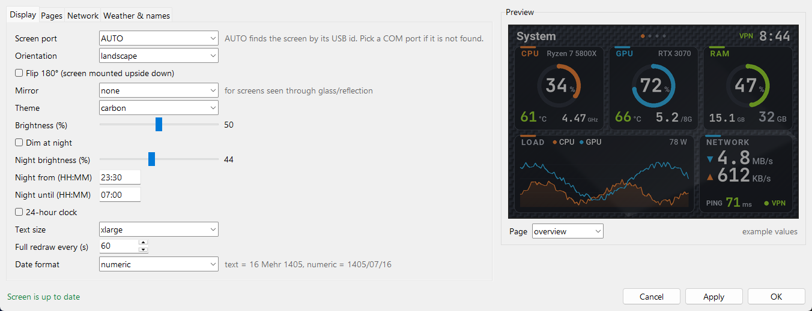

## نصب

۱. **دانلود**: دکمهٔ سبز **Code** ← **Download ZIP**، بعد آن را در یک پوشهٔ دائمی باز کنید (مثلاً `Documents\Smart-Screen`).

۲. نمایشگر را وصل کنید و اگر **UsbMonitor.exe** باز است، ببندیدش.

۳. روی **`install.bat`** دوبار کلیک کنید و اجازهٔ ادمین بدهید. این کارها را انجام می‌دهد:
   - UsbMonitor را می‌بندد و پیشنهاد می‌دهد اجرای خودکارش خاموش شود
   - پایتون را پیدا یا نصب می‌کند، `.venv` می‌سازد و پکیج‌ها را نصب می‌کند (فایل‌های آفلاین برای پایتون 3.14 همراه است؛ نسخه‌های دیگر از PyPI دانلود می‌شوند)
   - درایور **PawnIO** را که LibreHardwareMonitor برای دمای CPU لازم دارد نصب می‌کند
   - تسک **«Smart-Screen»** را می‌سازد (اجرا هنگام ورود به ویندوز، با دسترسی ادمین) و برنامه را اجرا می‌کند

۴. آیکون کنار ساعت ویندوز ظاهر می‌شود. راست‌کلیک ← **Settings…** برای انتخاب تم، جهت، صفحه‌ها، شهر آب‌وهوا و بقیه.

| فایل | کارش |
|---|---|
| `install.bat` | نصب یا به‌روزرسانی (اجرای دوباره مشکلی ندارد) |
| `start.bat` / `stop.bat` | اجرا / توقف برنامه در پس‌زمینه |
| `run-console.bat` | اجرا در پنجرهٔ کنسول برای دیدن خطاها |
| `uninstall.bat` | حذف تسک زمان‌بندی‌شده (فایل‌ها می‌مانند) |

تنظیمات در `config.yaml` کنار `main.py` ذخیره می‌شود و با تغییر فایل خودکار دوباره خوانده می‌شود. فایل گزارش: `smartscreen.log`.

## رفع مشکل

| مشکل | راه‌حل |
|---|---|
| در منوی آیکون «Screen not found» می‌بینید | UsbMonitor.exe را ببندید، کابل USB را جدا و وصل کنید، یا پورت COM را در Settings → Screen port انتخاب کنید |
| دمای CPU خالی است | برنامه باید با دسترسی ادمین اجرا شود (با `start.bat` یا تسک، نه `python main.py`) و PawnIO نصب باشد (`install.bat` را دوباره اجرا کنید) |
| تصویر وارونه است | منوی آیکون ← Rotate / Flip ← Flip 180° |
| متن خیلی ریز است | منوی آیکون ← Text size ← Large یا Extra large |
| تصویر کم‌رنگ قبلی زیر تم‌های تیره دیده می‌شود | این تصویر ماندگار LCD از برنامهٔ قبلی است: منوی آیکون ← Clear ghost image، یا تم‌های Aurora / Carbon |
| عوض شدن صفحه کند به نظر می‌رسد | این سرعت USB است (حدود ۱ ثانیه برای هر فریم کامل). Fade کشیده شدن را بهتر از همه پنهان می‌کند؛ None همان بازکشی ساده است |
| آب‌وهوا خالی می‌ماند | نام شهر را در Settings → Weather & names بررسی کنید؛ فایل گزارش (`smartscreen.log`) می‌گوید کدام جست‌وجو خطا داده |
| با VPN پینگ زیر ۱ میلی‌ثانیه است | مقصد را آدرس URL بگذارید (پیش‌فرض)، نه آدرس محلی؛ تأخیر به همین دلیل با HTTP اندازه گرفته می‌شود |

## برای برنامه‌نویس‌ها

ساختار کد و ابزارهای تست در [README انگلیسی](README.md#for-developers) آمده است.

## سپاس و مجوز

- درایور نمایشگر: [turing-smart-screen-python](https://github.com/mathoudebine/turing-smart-screen-python) از mathoudebine (GPL-3.0)
- حسگرها: [LibreHardwareMonitor](https://github.com/LibreHardwareMonitor/LibreHardwareMonitor) (MPL-2.0) و درایور [PawnIO](https://pawnio.eu/)
- آب‌وهوا: [Open-Meteo](https://open-meteo.com/)؛ IP و کشور: Cloudflare trace
- فونت‌ها: JetBrains Mono (OFL)، Roboto (Apache 2.0)، Race Space (رایگان برای استفادهٔ غیرتجاری)

Smart-Screen با مجوز **GNU GPL v3** منتشر شده است؛ [LICENSE](LICENSE) را ببینید.

