<h1 align="center">Smart-Screen</h1>

<p align="center"><a href="https://hits.sh/github.com/Plus98ir/Smart-Screen/"></a> <a href="https://corenetbase.com/#support"></a></p>

<details>
<summary><b>☕ Support · حمایت</b> — USDT (TRC20) / TRX</summary>
<br>
<p align="center"></p>

```
TA53aFyGNfSAcrCaJi9QmA9x5W47nPJcf7
```

> [!WARNING]
> **TRON network only.** Sending from ERC20 / BEP20 will lose the funds.<br>
> **فقط شبکه‌ی TRON.** ارسال از ERC20 یا BEP20 پول را از بین می‌برد.

</details>

<div align="center">

[🇬🇧 English](#english) | [🇮🇷 فارسی](#persian)

</div>

---

<a name="english"></a>

## 🇬🇧 English

<div align="center">

**A modern replacement for the "UsbMonitor" app of 3.5" USB system-monitor screens (Turing Smart Screen rev A and clones).**

[Website](https://plus98ir.github.io/Smart-Screen/)

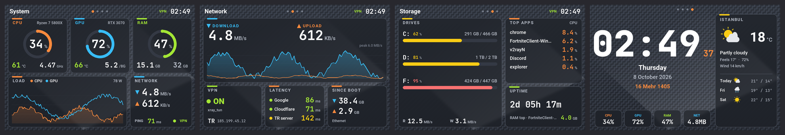

</div>

## Which screens does it work with?

Smart-Screen talks to the screen with the **rev A serial protocol** (USB CDC, 115200 baud). It works with:

| Screen | Size / resolution | How to recognise it |
|---|---|---|
| **Turing Smart Screen 3.5"** (original, rev A) | 3.5", 320×480 | USB ID `VID_1A86 & PID_5722` in Device Manager |
| **3.5" "UsbMonitor" / "UsbPCMonitor" IPS screens** (AliExpress / Amazon clones, often sold as "3.5 inch IPS USB-C computer monitor / AIDA64 sub-screen") | 3.5", 320×480 | Came with **UsbMonitor.exe**; USB serial number `USB35INCHIPSV2` |

Both are found automatically (by USB ID or serial number). If yours shows up as a different COM port, pick it by hand in **Settings → Screen port**.

**Not supported (different protocol):** Turing 2.1" / 5" / 8.8" (rev C), XuanFang 3.5" (rev B), Kipye / WeAct screens (rev D). For those, use [turing-smart-screen-python](https://github.com/mathoudebine/turing-smart-screen-python).

**Computer:** Windows 10 / 11, 64-bit. Python 3.10+ (the installer installs Python 3.14 with winget if none is found).

> Close the vendor **UsbMonitor.exe** first. Only one program can use the screen's COM port at a time; the installer offers to turn off its autostart.

## Features

- **4 pages**, rotating automatically or fixed:
  - **System**: CPU / GPU / RAM gauges, temperatures, clocks, power, load graph, network and ping
  - **Network**: download / upload graph, VPN status, public IP + country, HTTP latency to several targets (and your own server, optional), traffic since boot
  - **Storage**: every drive with fill bar, disk read / write, top apps by CPU, uptime
  - **Clock**: big clock, Gregorian + Jalali (Persian) date, weather with a 3-day forecast
- **8 themes**: HUD (sci-fi frame with ring gauges, one colour per metric), Pulse (one-panel dashboard with arc gauges and sparklines), Midnight, Neon (glow), Ember, Frost (light), Aurora and Carbon (textured backgrounds that hide LCD ghosting / burn-in)
- **Landscape and portrait**, plus **Flip 180°** and **Mirror** (horizontal / vertical) for screens mounted upside down or seen through glass
- **Page effects** when the page or theme changes: Fade, Fade + dissolve, Wipe (down / up / right / left), Curtain, Iris, Diagonal, Blinds, Checkerboard, Spiral, Dissolve or Random (see below)
- **Text size**: normal, large, extra large; values shrink to fit instead of overflowing
- **Brightness** and **night dimming** (time window)
- **Fast**: draws one frame a second and sends only the parts that changed, plus a full redraw every 60 s (or tray → Full redraw now) to clear anything a partial update missed
- **Tray icon** for everything (theme, page, rotation, brightness, screen off, restart) and a **Settings window with live preview**: nothing reaches the screen until you press Apply
- **Real temperatures** through LibreHardwareMonitor (CPU and GPU), with `nvidia-smi` as a fallback for NVIDIA cards
- **VPN-aware latency**: measured as an HTTP round trip on an open connection, so TUN-mode VPNs (v2rayN, sing-box, Clash…) can't fake a 1 ms ping
- **Weather that just works**: if the Open-Meteo city search is blocked on your network, the city is looked up with Photon / Nominatim instead
- **Clear ghost image**: a slow colour cycle at full brightness that helps fade LCD image retention
- **Starts with Windows** (scheduled task with admin rights, needed for CPU temperatures), no UAC prompt

## Screenshots

All 4 pages per theme (rendered by the app itself with sample data):

| Theme | Landscape (480×320) |
|---|---|
| HUD | 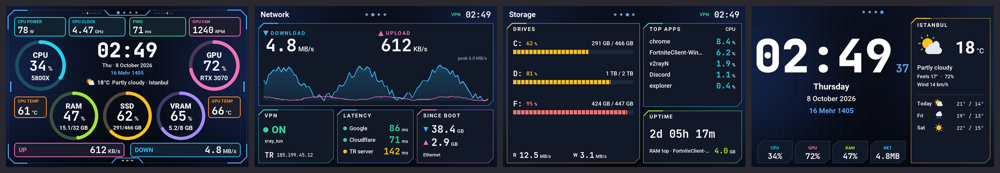 |
| Pulse | 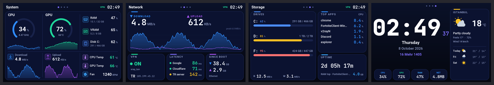 |
| Carbon |  |
| Aurora | 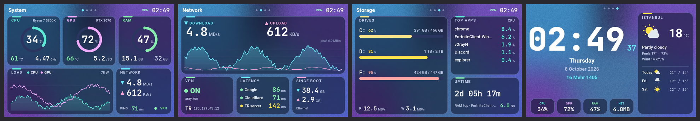 |
| Midnight | 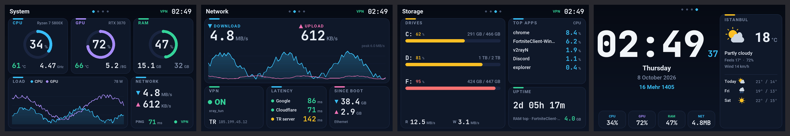 |
| Neon | 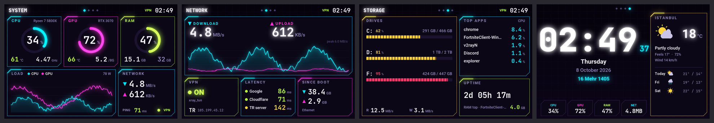 |
| Ember | 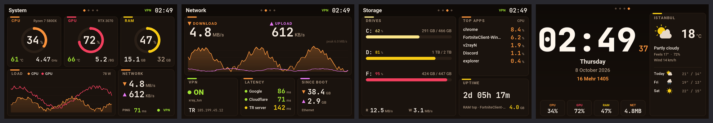 |
| Frost | 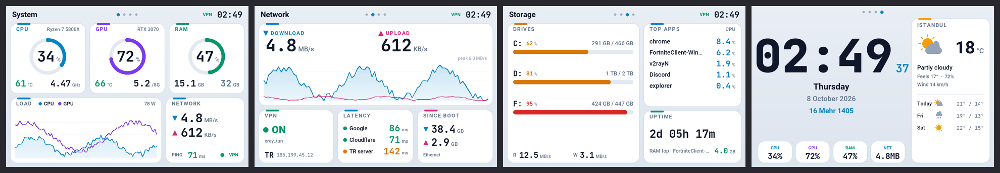 |

Portrait (320×480):

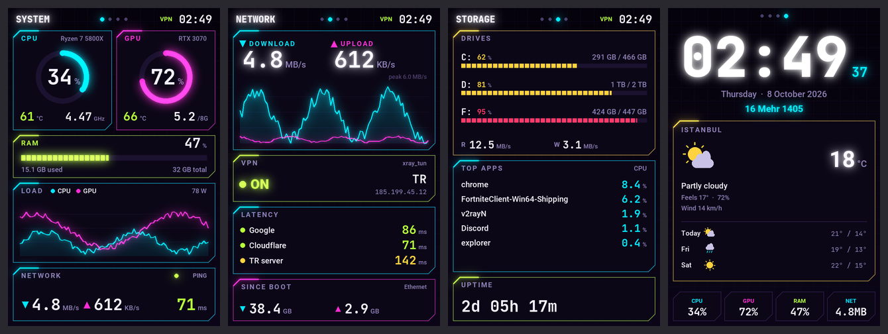

### Page effects

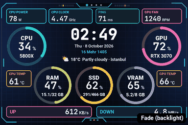

Pick one in tray → **Page effect** or **Settings → Display → Page effect** (default: **Fade**). The effect plays when the page or the theme changes; the normal once-a-second updates stay fast.

| Effect | What you see |
|---|---|
| Fade | backlight dims to black, the new page is drawn in the dark, then it fades back in (hides the drawing completely) |
| Fade + dissolve | dims, the new page appears block by block in random order, full brightness again |
| Wipe down / up / right / left | the new page comes in from one edge |
| Curtain | opens from the middle to both sides |
| Iris | grows from the centre outwards |
| Diagonal | from the top-left corner to the bottom-right |
| Blinds | all slats open at the same time |
| Checkerboard | first the "white" squares, then the "black" ones |
| Spiral | from the edges in to the centre |
| Dissolve | blocks in random order |
| Random | a different effect every time |
| None | plain redraw, top to bottom |

Directions follow Flip 180° and Mirror, so "Wipe down" really starts at the top of the screen as you see it.

**Why no rotate / zoom / slide?** The screen has no graphics chip: every pixel is sent over USB, and a full frame takes about a second. Smooth animations would need 25–30 full frames a second. So the effects are made from the *order* the new frame is sent in, and from the backlight (a 6-byte command), which costs no extra time.

Settings window with live preview:

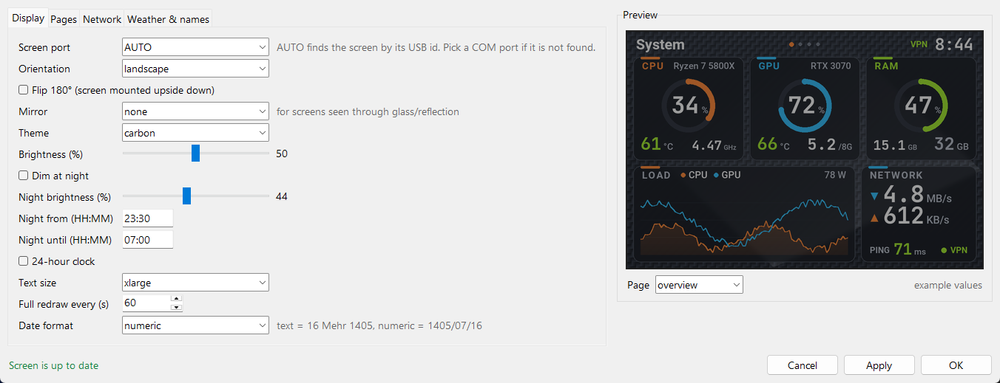

## Install

1. **Download**: green **Code** button → **Download ZIP**, then extract it to a permanent folder (for example `Documents\Smart-Screen`).
2. Plug in the screen and **close UsbMonitor.exe** if it is running.
3. Double-click **`install.bat`** and accept the admin prompt. It:
   - closes UsbMonitor and offers to turn off its autostart
   - finds or installs Python, creates `.venv` and installs the packages (offline wheels for Python 3.14 are included; other versions download from PyPI)
   - installs the **PawnIO** driver that LibreHardwareMonitor needs for CPU temperatures
   - creates the **"Smart-Screen"** scheduled task (starts at logon, with admin rights) and starts the app
4. The tray icon appears. Right-click → **Settings…** to pick theme, orientation, pages, weather city and more.

| File | What it does |
|---|---|
| `install.bat` | Install or update (safe to run again) |
| `start.bat` / `stop.bat` | Start / stop the background app |
| `run-console.bat` | Run in a console window to see errors |
| `uninstall.bat` | Remove the scheduled task (your files stay) |

Settings are saved in `config.yaml` next to `main.py` and reload by themselves when the file changes. The log is `smartscreen.log`.

## Troubleshooting

| Problem | Fix |
|---|---|
| "Screen not found" in the tray | Close UsbMonitor.exe, replug the USB cable, or pick the COM port in Settings → Screen port |
| CPU temperature is empty | The app must run as admin (use `start.bat` / the scheduled task, not `python main.py`) and PawnIO must be installed (run `install.bat` again) |
| Picture is upside down | Tray → Rotate / Flip → Flip 180° |
| Text is too small | Tray → Text size → Large or Extra large |
| Faint old image shows through dark themes | That is LCD retention from the old app: try tray → Clear ghost image, or the Aurora / Carbon themes |
| Page change looks slow | That is the USB speed (about 1 s per full frame). Fade hides the drawing best; None is the plain redraw |
| Weather stays empty | Check the city name in Settings → Weather & names; the log (`smartscreen.log`) says which lookup failed |
| Ping shows < 1 ms with a VPN | Use a URL target (default), not a local address; latency is measured over HTTP for this reason |

## For developers

```
main.py          app loop, page rotation, night dimming, tray menu
settings.py      Settings window (tkinter) with live preview
core/screen.py   partial updates: changed 16-px bands -> RGB565 -> screen
core/transitions.py  page effects: send order of strips / tiles, backlight fade
core/pages.py    the 4 pages, landscape + portrait layouts
core/themes.py   the 8 themes
core/sensors.py  psutil + LibreHardwareMonitor + nvidia-smi
core/online.py   latency, public IP / country, weather (open-meteo; Photon / Nominatim city search fallback)
library/lcd/     rev A driver from turing-smart-screen-python
tools/preview.py renders every theme/page to previews/ without a screen
tools/preview_effects.py  renders every page effect as a GIF to previews/effects/
tools/test_protocol.py  fake serial port that checks partial updates and every effect rebuild the exact frame
```

```
python tools/preview.py            # or: python tools/preview.py xlarge
python tools/preview_effects.py
python tools/test_protocol.py
```

## Credits and license

- Screen driver: [turing-smart-screen-python](https://github.com/mathoudebine/turing-smart-screen-python) by mathoudebine (GPL-3.0)
- Sensors: [LibreHardwareMonitor](https://github.com/LibreHardwareMonitor/LibreHardwareMonitor) (MPL-2.0) and the [PawnIO](https://pawnio.eu/) driver
- Weather: [Open-Meteo](https://open-meteo.com/); IP / country: Cloudflare trace
- Fonts: JetBrains Mono (OFL), Roboto (Apache 2.0), Race Space (free for non-commercial use)

Smart-Screen is released under the **GNU GPL v3**, see [LICENSE](LICENSE).

---

<a name="persian"></a>

## 🇮🇷 فارسی

<div align="center">

[🇬🇧 English](#english) | [🇮🇷 فارسی](#persian)

</div>

<div dir="rtl">

<div align="center">

**جایگزین مدرن برنامهٔ «UsbMonitor» برای نمایشگرهای ۳٫۵ اینچی USB مانیتورینگ سیستم (Turing Smart Screen نسخهٔ rev A و مشابه‌ها).**

[وب‌سایت](https://plus98ir.github.io/Smart-Screen/)


</div>

## با چه نمایشگرهایی کار می‌کند؟

Smart-Screen با **پروتکل سریال rev A** (USB CDC، سرعت 115200) با نمایشگر صحبت می‌کند و مخصوص این مدل‌هاست:

| نمایشگر | اندازه / رزولوشن | چطور بشناسیم |
|---|---|---|
| **Turing Smart Screen 3.5"** (اصلی، rev A) | ۳٫۵ اینچ، 320×480 | شناسهٔ USB در Device Manager: `VID_1A86 & PID_5722` |
| **نمایشگرهای IPS سه‌ونیم اینچی «UsbMonitor» / «UsbPCMonitor»** (مدل‌های علی‌اکسپرس و آمازون، معمولاً با نام «3.5 inch IPS USB-C computer monitor / AIDA64 sub-screen») | ۳٫۵ اینچ، 320×480 | همراهش برنامهٔ **UsbMonitor.exe** آمده؛ شمارهٔ سریال USB: `USB35INCHIPSV2` |

هر دو خودکار پیدا می‌شوند (با شناسهٔ USB یا شمارهٔ سریال). اگر نمایشگر شما روی پورت COM دیگری بود، در **Settings → Screen port** دستی انتخابش کنید.

**پشتیبانی نمی‌شود (پروتکل متفاوت):** Turing مدل‌های ۲٫۱، ۵ و ۸٫۸ اینچ (rev C)، XuanFang سه‌ونیم اینچ (rev B)، Kipye و WeAct (rev D). برای این‌ها از [turing-smart-screen-python](https://github.com/mathoudebine/turing-smart-screen-python) استفاده کنید.

**کامپیوتر:** ویندوز ۱۰ یا ۱۱ (۶۴ بیتی). پایتون 3.10 به بالا (اگر نباشد، نصب‌کننده پایتون 3.14 را با winget نصب می‌کند).

> اول برنامهٔ سازنده یعنی **UsbMonitor.exe** را ببندید. پورت COM نمایشگر فقط دست یک برنامه می‌تواند باشد؛ نصب‌کننده پیشنهاد می‌دهد اجرای خودکارش را خاموش کند.

## امکانات

- **۴ صفحه** که خودکار عوض می‌شوند یا ثابت می‌مانند:
  - **System**: گیج CPU / GPU / RAM، دما، فرکانس، توان، نمودار بار، شبکه و پینگ
  - **Network**: نمودار دانلود / آپلود، وضعیت VPN، IP عمومی و کشور، تأخیر HTTP به چند مقصد (و سرور خودتان، اختیاری)، ترافیک از زمان روشن شدن
  - **Storage**: همهٔ درایوها با نوار پرشدگی، سرعت خواندن / نوشتن دیسک، پرمصرف‌ترین برنامه‌ها، مدت روشن بودن
  - **Clock**: ساعت بزرگ، تاریخ میلادی و **شمسی**، آب‌وهوا با پیش‌بینی ۳ روزه
- **۸ تم**: HUD (قاب علمی‌تخیلی با گیج‌های حلقه‌ای، هر معیار یک رنگ)، Pulse (داشبورد یک‌تکه با گیج کمانی و نمودارهای کوچک)، Midnight، Neon (درخشان)، Ember، Frost (روشن)، Aurora و Carbon (پس‌زمینهٔ بافت‌دار که سایهٔ تصویر قبلی / سوختگی LCD را می‌پوشاند)
- **افقی و عمودی**، به‌علاوهٔ **چرخش ۱۸۰ درجه** و **آینه** (افقی / عمودی) برای نمایشگری که وارونه نصب شده یا از پشت شیشه دیده می‌شود
- **افکت عوض شدن صفحه** هنگام تغییر صفحه یا تم: Fade، Fade + dissolve، Wipe (پایین / بالا / راست / چپ)، Curtain، Iris، Diagonal، Blinds، Checkerboard، Spiral، Dissolve یا Random (پایین‌تر را ببینید)
- **اندازهٔ متن**: معمولی، بزرگ، خیلی بزرگ؛ عددها به‌جای بیرون زدن کوچک می‌شوند
- **روشنایی** و **کم‌نور شدن در شب** (بازهٔ ساعت)
- **سریع**: هر ثانیه یک فریم می‌کشد و فقط بخش‌های تغییرکرده را می‌فرستد، به‌علاوهٔ بازکشی کامل هر ۶۰ ثانیه (یا منوی آیکون ← Full redraw now) تا چیزی جا نماند
- **آیکون کنار ساعت ویندوز** برای همه‌چیز (تم، صفحه، چرخش، روشنایی، خاموش کردن نمایشگر، ری‌استارت) و **پنجرهٔ تنظیمات با پیش‌نمایش زنده**: تا Apply نزنید چیزی روی نمایشگر نمی‌رود
- **دمای واقعی** با LibreHardwareMonitor (CPU و کارت گرافیک) و `nvidia-smi` به‌عنوان پشتیبان برای کارت‌های NVIDIA
- **پینگ درست با VPN**: تأخیر به‌صورت رفت‌وبرگشت HTTP روی اتصال باز اندازه گرفته می‌شود تا VPNهای حالت TUN (v2rayN، sing-box، Clash و…) پینگ ۱ میلی‌ثانیه‌ای الکی نشان ندهند
- **آب‌وهوای مطمئن**: اگر جست‌وجوی شهر Open-Meteo روی شبکهٔ شما باز نشود، شهر از Photon / Nominatim پیدا می‌شود
- **پاک کردن سایهٔ تصویر**: چرخهٔ آرام رنگ با روشنایی کامل که به محو شدن تصویر ماندگار LCD کمک می‌کند
- **اجرا همراه ویندوز** (تسک زمان‌بندی‌شده با دسترسی ادمین که برای دمای CPU لازم است)، بدون پنجرهٔ UAC

## تصاویر

هر ۴ صفحه برای هر تم (خود برنامه با داده‌های نمونه کشیده است):

| تم | افقی (480×320) |
|---|---|
| HUD |  |
| Pulse |  |
| Carbon |  |
| Aurora |  |
| Midnight |  |
| Neon |  |
| Ember |  |
| Frost |  |

عمودی (320×480):


### افکت عوض شدن صفحه


از منوی آیکون ← **Page effect** یا **Settings → Display → Page effect** انتخاب کنید (پیش‌فرض: **Fade**). افکت وقتی اجرا می‌شود که صفحه یا تم عوض شود؛ به‌روزرسانی معمولی هر ثانیه همچنان سریع می‌ماند.

| افکت | چه می‌بینید |
|---|---|
| Fade | نور پس‌زمینه تا سیاه کم می‌شود، صفحهٔ جدید در تاریکی کشیده می‌شود و بعد آرام روشن می‌شود (کشیده شدن اصلاً دیده نمی‌شود) |
| Fade + dissolve | کم‌نور می‌شود، صفحهٔ جدید تکه‌تکه با ترتیب تصادفی ظاهر می‌شود، بعد روشنایی کامل |
| Wipe down / up / right / left | صفحهٔ جدید از یک لبه وارد می‌شود |
| Curtain | مثل پرده از وسط به دو طرف باز می‌شود |
| Iris | از مرکز به بیرون باز می‌شود |
| Diagonal | مورب، از گوشهٔ بالا چپ تا پایین راست |
| Blinds | مثل کرکره، همهٔ تیغه‌ها با هم |
| Checkerboard | اول خانه‌های «سفید» شطرنج، بعد «سیاه»‌ها |
| Spiral | مارپیچ از لبه‌ها به مرکز |
| Dissolve | تکه‌ها با ترتیب تصادفی |
| Random | هر بار یک افکت متفاوت |
| None | بازکشی ساده از بالا به پایین |

جهت‌ها با Flip 180° و Mirror هماهنگ‌اند؛ یعنی «Wipe down» از دید شما واقعاً از بالای نمایشگر شروع می‌شود.

**چرا چرخش / زوم / اسلاید نیست؟** این نمایشگر چیپ گرافیکی ندارد: همهٔ پیکسل‌ها از USB فرستاده می‌شوند و یک فریم کامل حدود یک ثانیه طول می‌کشد، در حالی که انیمیشن نرم ۲۵ تا ۳۰ فریم کامل در ثانیه لازم دارد. برای همین افکت‌ها از ترتیب ارسال فریم جدید و از نور پس‌زمینه (یک دستور ۶ بایتی) ساخته شده‌اند و هیچ زمان اضافه‌ای نمی‌گیرند.

پنجرهٔ تنظیمات با پیش‌نمایش زنده:


## نصب

۱. **دانلود**: دکمهٔ سبز **Code** ← **Download ZIP**، بعد آن را در یک پوشهٔ دائمی باز کنید (مثلاً `Documents\Smart-Screen`).

۲. نمایشگر را وصل کنید و اگر **UsbMonitor.exe** باز است، ببندیدش.

۳. روی **`install.bat`** دوبار کلیک کنید و اجازهٔ ادمین بدهید. این کارها را انجام می‌دهد:
   - UsbMonitor را می‌بندد و پیشنهاد می‌دهد اجرای خودکارش خاموش شود
   - پایتون را پیدا یا نصب می‌کند، `.venv` می‌سازد و پکیج‌ها را نصب می‌کند (فایل‌های آفلاین برای پایتون 3.14 همراه است؛ نسخه‌های دیگر از PyPI دانلود می‌شوند)
   - درایور **PawnIO** را که LibreHardwareMonitor برای دمای CPU لازم دارد نصب می‌کند
   - تسک **«Smart-Screen»** را می‌سازد (اجرا هنگام ورود به ویندوز، با دسترسی ادمین) و برنامه را اجرا می‌کند

۴. آیکون کنار ساعت ویندوز ظاهر می‌شود. راست‌کلیک ← **Settings…** برای انتخاب تم، جهت، صفحه‌ها، شهر آب‌وهوا و بقیه.

| فایل | کارش |
|---|---|
| `install.bat` | نصب یا به‌روزرسانی (اجرای دوباره مشکلی ندارد) |
| `start.bat` / `stop.bat` | اجرا / توقف برنامه در پس‌زمینه |
| `run-console.bat` | اجرا در پنجرهٔ کنسول برای دیدن خطاها |
| `uninstall.bat` | حذف تسک زمان‌بندی‌شده (فایل‌ها می‌مانند) |

تنظیمات در `config.yaml` کنار `main.py` ذخیره می‌شود و با تغییر فایل خودکار دوباره خوانده می‌شود. فایل گزارش: `smartscreen.log`.

## رفع مشکل

| مشکل | راه‌حل |
|---|---|
| در منوی آیکون «Screen not found» می‌بینید | UsbMonitor.exe را ببندید، کابل USB را جدا و وصل کنید، یا پورت COM را در Settings → Screen port انتخاب کنید |
| دمای CPU خالی است | برنامه باید با دسترسی ادمین اجرا شود (با `start.bat` یا تسک، نه `python main.py`) و PawnIO نصب باشد (`install.bat` را دوباره اجرا کنید) |
| تصویر وارونه است | منوی آیکون ← Rotate / Flip ← Flip 180° |
| متن خیلی ریز است | منوی آیکون ← Text size ← Large یا Extra large |
| تصویر کم‌رنگ قبلی زیر تم‌های تیره دیده می‌شود | این تصویر ماندگار LCD از برنامهٔ قبلی است: منوی آیکون ← Clear ghost image، یا تم‌های Aurora / Carbon |
| عوض شدن صفحه کند به نظر می‌رسد | این سرعت USB است (حدود ۱ ثانیه برای هر فریم کامل). Fade کشیده شدن را بهتر از همه پنهان می‌کند؛ None همان بازکشی ساده است |
| آب‌وهوا خالی می‌ماند | نام شهر را در Settings → Weather & names بررسی کنید؛ فایل گزارش (`smartscreen.log`) می‌گوید کدام جست‌وجو خطا داده |
| با VPN پینگ زیر ۱ میلی‌ثانیه است | مقصد را آدرس URL بگذارید (پیش‌فرض)، نه آدرس محلی؛ تأخیر به همین دلیل با HTTP اندازه گرفته می‌شود |

## برای برنامه‌نویس‌ها

ساختار کد و ابزارهای تست در [README انگلیسی](README.md#for-developers) آمده است.

## سپاس و مجوز

- درایور نمایشگر: [turing-smart-screen-python](https://github.com/mathoudebine/turing-smart-screen-python) از mathoudebine (GPL-3.0)
- حسگرها: [LibreHardwareMonitor](https://github.com/LibreHardwareMonitor/LibreHardwareMonitor) (MPL-2.0) و درایور [PawnIO](https://pawnio.eu/)
- آب‌وهوا: [Open-Meteo](https://open-meteo.com/)؛ IP و کشور: Cloudflare trace
- فونت‌ها: JetBrains Mono (OFL)، Roboto (Apache 2.0)، Race Space (رایگان برای استفادهٔ غیرتجاری)

Smart-Screen با مجوز **GNU GPL v3** منتشر شده است؛ [LICENSE](LICENSE) را ببینید.

</div>
